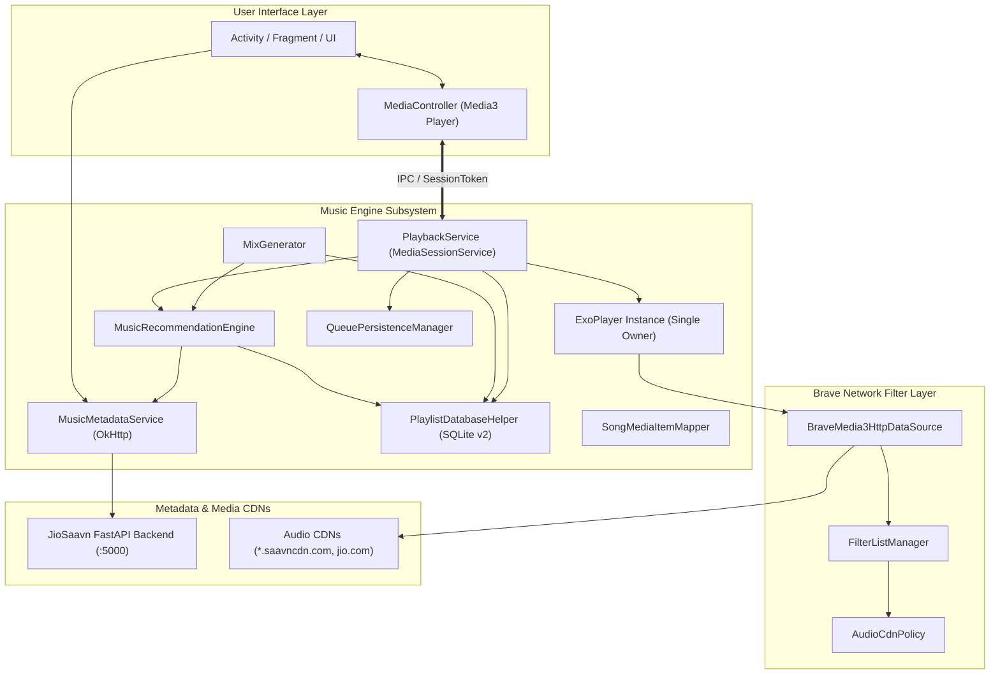

# Complete Music Engine Architectural & Implementation Specification

This document provides a comprehensive technical reference for the music playback, recommendation, and discovery engine extracted from the **Brave Music Player** project.

---

## 1. Architectural Overview & Component Inventory



### Complete Class & File Inventory

| Module / Package | Class / File | Primary Responsibility |
|---|---|---|
| `:filter-core` | `com.braveplayer.filter.manager.FilterListManager` | Thread-safe adblock rule evaluation, atomic swap updates, and telemetry stats |
| `:filter-core` | `com.braveplayer.filter.policy.AudioCdnPolicy` | Protects audio CDN hostnames and preserves provider-required ads |
| `:music-engine` / `model` | `com.braveplayer.music.model.Song` | Data model for music tracks with candidate URL resolution |
| `:music-engine` / `model` | `com.braveplayer.music.model.SearchResponseParser` | Parses FastAPI search JSON, cleans HTML entities, extracts candidate URLs |
| `:music-engine` / `api` | `com.braveplayer.music.api.MusicMetadataService` | Bounded OkHttp client executing `/search` queries with retries |
| `:music-engine` / `media` | `com.braveplayer.music.media.BraveMedia3HttpDataSource` | Media3 HttpDataSource wrapper enforcing audio CDN policy |
| `:music-engine` / `media` | `com.braveplayer.music.media.SongMediaItemMapper` | Maps between domain `Song` and Media3 `MediaItem` with metadata & candidate URLs |
| `:music-engine` / `service` | `com.braveplayer.music.service.PlaybackService` | MediaSessionService owning ExoPlayer, notification, history, and autoplay |
| `:music-engine` / `settings` | `com.braveplayer.music.settings.AppSettings` | Manages base URL and autoplay on/off preference in SharedPreferences |
| `:music-engine` / `settings` | `com.braveplayer.music.settings.QueuePersistenceManager` | Persists queue, current index, position, repeat, and shuffle safely |
| `:music-engine` / `settings` | `com.braveplayer.music.settings.FilterEngineProvider` | Singleton provider sharing FilterListManager across API and audio playback |
| `:music-engine` / `playlist` | `com.braveplayer.music.playlist.PlaylistDatabaseHelper` | SQLite persistence for Playlists, Liked Songs, and 500-record Listening History |
| `:music-engine` / `discovery` | `com.braveplayer.music.discovery.MusicRecommendationEngine` | Local ranking engine with candidate caching and affinity scoring |
| `:music-engine` / `discovery` | `com.braveplayer.music.discovery.MixGenerator` | Generates Daily Mix and Discovery Mix with novelty scoring |

---

## 2. Music Search, Metadata & Audio Stream Flow

### Data Model: `Song.kt`
```kotlin
data class Song(
    val id: String,
    val title: String,
    val artists: String,
    val album: String,
    val imageUrl: String?,
    val durationSec: Int,
    val mediaUrl: String?,
    val mediaUrlDefault: String?,
    val previewUrl: String?
)
```
- **Candidate URLs Order of Preference**:
  1. `mediaUrlDefault` (e.g. `https://aac.saavncdn.com/..._96.mp4`): Direct AAC stream, highly reliable on JioSaavn CDNs.
  2. `mediaUrl` (e.g. `https://aac.saavncdn.com/..._320.mp3`): High-bitrate MP3, frequently returns HTTP 404 from older catalog entries.
  3. `previewUrl` (e.g. `https://jiotunepreview.jio.com/...mp3`): Preview clip fallback.
- **Helper Method**: `Song.getCandidatePlaybackUrls(): List<String>` returns only valid HTTP/HTTPS URLs containing audio extensions (`.mp4`, `.mp3`, `.m4a`, `.aac`, `.opus`, `videoplayback`).

### Search Parsing: `SearchResponseParser.kt`
- Parses FastAPI `/search?query={q}` JSON:
  - Supports both root array `[...]` and object format `{"result": [...]}`.
  - Extracts title, album, artists (from `artistMap.primary_artists` array or `subtitle` string).
  - Normalizes durations (converts string seconds to `Int`).
  - Decodes HTML entities: `&quot;`, `&amp;`, `&#039;`, `&lt;`, `&gt;`.

### API Service: `MusicMetadataService.kt`
- Signature:
  ```kotlin
  suspend fun searchSongs(baseUrl: String, query: String, maxRetries: Int = 2): SearchResult
  ```
- **Tagging**: Headers include `X-Player-Request-Type: METADATA_API`, intercepted by `FilteringOkHttpInterceptor`.
- **Bounded Retries**: Performs up to 2 retries with exponential backoff (`delay(200L * (attempt + 1))`) for HTTP 5xx responses or `IOException`.

---

## 3. Background Playback & Media3 Architecture

### Service Lifecycle & ExoPlayer Ownership
`PlaybackService` extends `androidx.media3.session.MediaSessionService`.
- **Single-Player Ownership**: Only `PlaybackService` instantiates `ExoPlayer`. Activities connect exclusively through `MediaController`.
- **Audio Attributes**:
  ```kotlin
  AudioAttributes.Builder()
      .setUsage(C.USAGE_MEDIA)
      .setContentType(C.AUDIO_CONTENT_TYPE_MUSIC)
      .build()
  ```
  Configured with `setAudioAttributes(audioAttributes, true)` for automatic audio focus ducking/pausing, and `setHandleAudioBecomingNoisy(true)` to pause automatically when headphones are unplugged.
- **Android 14 (API 34) Foreground Service**:
  - Declared in Manifest:
    ```xml
    <service
        android:name="com.braveplayer.music.service.PlaybackService"
        android:exported="true"
        android:foregroundServiceType="mediaPlayback">
        <intent-filter>
            <action android:name="androidx.media3.session.MediaSessionService" />
        </intent-filter>
    </service>
    ```
  - Notification channel ID: `brave_playback_channel` (`NotificationManager.IMPORTANCE_LOW`).
  - Provider: `DefaultMediaNotificationProvider.Builder(this).setChannelId(CHANNEL_ID).build()`.
  - Notification tap intent: Uses `packageManager.getLaunchIntentForPackage(packageName)` to launch the host app's top activity without hardcoded class dependencies.

---

## 4. Queue Management, Autoplay & Candidate Failover

### MediaItem Mapping: `SongMediaItemMapper.kt`
- Stores candidate URLs and track metadata in `MediaItem.mediaMetadata.extras`:
  - `EXTRA_CANDIDATE_URLS`: `ArrayList<String>`
  - `EXTRA_CURRENT_URL_INDEX`: `Int`
  - `EXTRA_SONG_ID`, `EXTRA_DURATION_SEC`, `EXTRA_ALBUM`, etc.
- `createFallbackMediaItem(mediaItem, nextCandidateIndex)`: Rebuilds `MediaItem` pointing to the next available stream URL.

### Candidate URL Failover in `PlaybackService.kt`
When `onPlayerError(error: PlaybackException)` fires:
1. Checks if current item has alternate candidate URLs in `mediaMetadata.extras`.
2. Replaces the current item via `exoPlayer.replaceMediaItem(currentIndex, fallbackItem)`.
3. Calls `prepare()` and `play()`.
4. If all candidates fail: adds `songId` to `failedTrackIds` (to prevent recommendation repeats) and calls `exoPlayer.seekToNextMediaItem()`.

### Autoplay Queue Extension (`checkAndExtendQueueIfNeeded`)
- **Safety Guards**:
  - Suppressed if `appSettings.isAutoplayEnabled() == false`.
  - Suppressed if user has never started playback (`!hasEverStartedPlayback`).
  - Suppressed if repeat mode is active (`repeatMode != Player.REPEAT_MODE_OFF`).
  - Suppressed if queue extension is already in-flight (`isExtendingQueue`).
- **Trigger**: Fired when `currentIndex >= mediaItemCount - 1` or `playbackState == Player.STATE_ENDED`.
- **Extension Flow**:
  1. Identifies the last queued song as seed.
  2. Queries `MusicRecommendationEngine.getRecommendations(baseUrl, seedSong, excludeIds, limit = 5)`.
  3. Appends new items using `exoPlayer.addMediaItems(newMediaItems)`.
  4. Keeps manually queued items ahead; does not interrupt active playback.

---

## 5. Liked Songs, Playlists & Listening History (SQLite v2)

Database: `brave_playlists.db`, Version `2`.

### Schema Specification
```sql
-- Playlists Table
CREATE TABLE playlists (
    id INTEGER PRIMARY KEY AUTOINCREMENT,
    name TEXT NOT NULL UNIQUE,
    created_at INTEGER NOT NULL
);

-- Playlist Songs Table
CREATE TABLE playlist_songs (
    id INTEGER PRIMARY KEY AUTOINCREMENT,
    playlist_id INTEGER NOT NULL,
    song_id TEXT NOT NULL,
    title TEXT NOT NULL,
    artists TEXT NOT NULL,
    album TEXT NOT NULL,
    image_url TEXT,
    duration_sec INTEGER NOT NULL,
    media_url TEXT,
    media_url_default TEXT,
    preview_url TEXT,
    sort_order INTEGER NOT NULL,
    FOREIGN KEY(playlist_id) REFERENCES playlists(id) ON DELETE CASCADE
);

-- Liked Songs Table (Feature 1)
CREATE TABLE liked_songs (
    song_id TEXT PRIMARY KEY,
    title TEXT NOT NULL,
    artists TEXT NOT NULL,
    album TEXT NOT NULL,
    image_url TEXT,
    duration_sec INTEGER NOT NULL,
    media_url TEXT,
    media_url_default TEXT,
    preview_url TEXT,
    liked_at INTEGER NOT NULL
);

-- Listening History Table (Feature 5)
CREATE TABLE listening_history (
    id INTEGER PRIMARY KEY AUTOINCREMENT,
    song_id TEXT NOT NULL,
    title TEXT NOT NULL,
    artists TEXT NOT NULL,
    album TEXT NOT NULL,
    image_url TEXT,
    duration_sec INTEGER NOT NULL,
    media_url TEXT,
    media_url_default TEXT,
    preview_url TEXT,
    played_at INTEGER NOT NULL,
    play_duration_sec INTEGER NOT NULL,
    completed INTEGER NOT NULL DEFAULT 0,
    skipped INTEGER NOT NULL DEFAULT 0,
    meaningful_play INTEGER NOT NULL DEFAULT 0
);
CREATE INDEX idx_history_played_at ON listening_history(played_at DESC);
CREATE INDEX idx_history_song_id ON listening_history(song_id);
```

### Listening History Rules & Capping
- **Meaningful Play**: `playDurationSec >= 30` or `playDurationSec >= durationSec * 0.30`.
- **Completed**: `playDurationSec >= durationSec * 0.85` or transitioned automatically.
- **Skipped**: `!isCompleted && playDurationSec < 30`.
- **Storage Growth Cap**: Auto-prunes rows beyond the 500 newest entries on every insert:
  ```sql
  DELETE FROM listening_history
  WHERE id NOT IN (
      SELECT id FROM listening_history ORDER BY played_at DESC LIMIT 500
  );
  ```

---

## 6. Recommendation Engine & Personalized Mixes

### Scoring Algorithm: `MusicRecommendationEngine.kt`
Evaluates candidate tracks against the seed track and user history:

| Criteria | Weight | Rationale |
|---|---|---|
| Exact Primary Artist Match | `+45.0` | High affinity for the seed artist |
| Related / Shared Artist | `+30.0` | Collaboration or featured artist match |
| Album Match | `+20.0` | Same album continuity |
| Liked Song Affinity | `+35.0` | Explicit user endorsement |
| Frequent Artist Bonus | Up to `+25.0` | Boosts artists user plays often (`plays * 3.0`) |
| History Skip Penalty | `-30.0` | Demotes songs user skipped in <30 seconds |
| Standard Track Duration | `+5.0` | Bonus for complete songs (120–420s) |

- **Candidate Caching**: `LruCache<String, Pair<Long, List<Song>>>(40)` with a 10-minute TTL.
- **Deduplication**: Normalized by `title.trim().lowercase() | artists.trim().lowercase()`.

### Mix Generation: `MixGenerator.kt`
- **Daily Mix**: Blends top most-played tracks, liked songs, and seed recommendations.
- **Discovery Mix**: Identifies candidate songs whose primary artists are **not** in the user's frequent rotation (`frequentArtists`).
  - Novel artist bonus: `+50.0`.
  - Artist variety bonus: `+20.0` for unique artists in mix.
  - Familiar artist penalty: `-30.0`.
  - Excludes already liked songs and recent history so user discovers fresh music.
- **Mix Persistence**: `saveMixAsPlaylist(mix, customName)` stores the mix as a permanent SQLite playlist that the user can edit or delete.

---

## 7. Connecting UI to Engine via MediaController

In your Activity or Fragment:

```kotlin
class PlayerActivity : AppCompatActivity() {

    private var mediaController: MediaController? = null
    private var controllerFuture: ListenableFuture<MediaController>? = null

    override fun onCreate(savedInstanceState: Bundle?) {
        super.onCreate(savedInstanceState)
        connectToService()
    }

    private fun connectToService() {
        val sessionToken = SessionToken(this, ComponentName(this, PlaybackService::class.java))
        val future = MediaController.Builder(this, sessionToken).buildAsync()
        future.addListener({
            mediaController = future.get()
            mediaController?.addListener(object : Player.Listener {
                override fun onPlaybackStateChanged(state: Int) { /* update UI */ }
                override fun onIsPlayingChanged(isPlaying: Boolean) { /* update play/pause icon */ }
                override fun onMediaItemTransition(item: MediaItem?, reason: Int) { /* update track details */ }
            })
        }, ContextCompat.getMainExecutor(this))
        controllerFuture = future
    }

    override fun onDestroy() {
        super.onDestroy()
        controllerFuture?.let { MediaController.releaseFuture(it) }
        mediaController = null
    }
}
```
